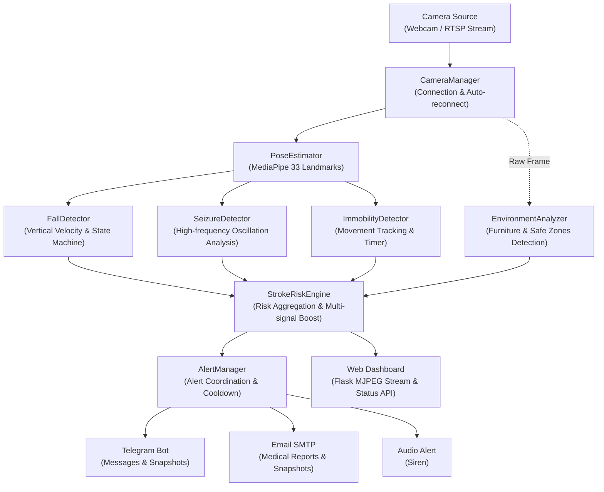

# Stroke Risk Detection System

> **NOTE**
> This is an **academic student project** intended for research, learning, and technology demonstration purposes. The system is **not a commercial medical device** and does not replace professional medical diagnosis or prescription.

---

## System Architecture

Below is the data flow and structure of the processing modules within the system:

### Module Descriptions

1. **CameraManager**: Captures the video stream from a local Webcam or an IP Camera's RTSP stream. Handles resolution configuration, FPS, and an automatic reconnection mechanism upon network loss.
2. **PoseEstimator**: Utilizes the Google MediaPipe Pose algorithm to extract 33 normalized body landmarks in real-time. Calculates the body's center of mass (`torso_center`), estimated height (`body_height`), and body angle (`body_angle`).
3. **FallDetector**: Detects falls based on the vertical drop velocity of the torso and a multi-stage Finite State Machine (FSM).
4. **SeizureDetector**: Analyzes high-frequency oscillations of limbs and the head within a sliding time window to identify potential seizure activities.
5. **ImmobilityDetector**: Measures the total body displacement over time when the subject is near the floor to detect prolonged immobility.
6. **EnvironmentAnalyzer**: Recognizes the living environment context (beds, sofas, custom safe zones) to filter out natural resting behaviors and reduce false positives.
7. **StrokeRiskEngine**: The central coordinator. Aggregates events, evaluates confidence scores, applies multi-signal boosting (e.g., fall followed by immobility), determines the overall risk level, and renders the HUD on the video frame.
8. **AlertManager**: Manages non-blocking asynchronous alerts via Telegram, Email, and local audio. Integrates a cooldown mechanism to prevent notification spam.
9. **Dashboard**: A Flask-based web application providing real-time monitoring via MJPEG streaming, system settings, and RESTful APIs for status updates.

---

## Detection Algorithms

### 1. Fall Detection

- **Working Principle**:
  - The system maintains a sliding queue of the last 30 frames' movement history.
  - Vertical fall velocity is calculated based on the rate of change of the torso's Y-coordinate.
  - Combines velocity with the `body_angle` relative to the horizontal plane. A rapid transition from approximately 90 degrees to under 45 degrees triggers the fall logic.
  - Uses a **Finite State Machine (FSM)** with 5 states: `STANDING`, `FALLING`, `ON_FLOOR`, `RECOVERED`, and `CONFIRMED_FALL`.
  - If the subject recovers before the `FALL_RECOVERY_TIMEOUT` (3 seconds), the alert is canceled.

### 2. Seizure Detection

- **Working Principle**:
  - Seizures are characterized by low-amplitude, high-frequency repetitive muscle contractions.
  - The system tracks the coordinates of **7 key body parts**: wrists, ankles, knees, and nose.
  - Data is extracted within a sliding `SEIZURE_WINDOW_SECONDS` (3 seconds).
  - **Oscillation Counting**: Analyzes the derivative of position over time to count direction reversals. Minor vibrations below the noise threshold are filtered out.
  - **Multi-limb Aggregation**: A seizure event is only confirmed if at least 2 body parts simultaneously oscillate beyond the `SEIZURE_OSCILLATION_THRESHOLD` (8 times) with sufficient amplitude.

### 3. Immobility Detection

- **Working Principle**:
  - After a fall or sudden collapse, a stroke victim often remains completely immobile.
  - The system continuously calculates the displacement of the overall bounding box center.
  - If the cumulative displacement over time remains below the `IMMOBILITY_MOVEMENT_THRESHOLD` while the subject is near the floor, a timer starts.
  - Passing the `IMMOBILITY_TIMEOUT` triggers escalating alerts (Medium -> High -> Critical).

---

## Customization & Configuration

All system operational parameters are centralized in `config.py`. You can easily adjust sensitivities to fit realistic room environments.

| Parameter | Default Value | Description |
|:---|:---:|:---|
| `FALL_VELOCITY_THRESHOLD` | `0.12` | Minimum vertical drop velocity to detect a fall. Decrease for higher sensitivity. |
| `FALL_ANGLE_THRESHOLD` | `45.0` | Body angle threshold (degrees). |
| `FALL_RECOVERY_TIMEOUT` | `3.0` | Grace period (seconds) before confirming a fall alert. |
| `SEIZURE_OSCILLATION_THRESHOLD` | `8` | Minimum direction reversals within the time window to confirm a seizure. |
| `SEIZURE_WINDOW_SECONDS` | `3.0` | Sliding time window duration (seconds) for oscillation analysis. |
| `SEIZURE_MIN_AMPLITUDE` | `0.015` | Minimum oscillation amplitude. Filters out minor hand tremors. |
| `IMMOBILITY_TIMEOUT` | `30.0` | Seconds of being immobile on the floor before escalating the alert. |
| `IMMOBILITY_MOVEMENT_THRESHOLD` | `0.008` | Maximum coordinate shift allowed to still be considered immobile. |
| `CONFIDENCE_THRESHOLD` | `0.55` | Minimum AI confidence score required to trigger system alerts. |
| `ALERT_COOLDOWN` | `60` | Minimum interval (seconds) between sending external alerts to prevent spam. |

---

## Web Dashboard

The system includes a modern Web Dashboard for remote monitoring without needing physical access to the host computer:

- **Access**: Open a web browser and navigate to `http://localhost:5000` (or the host's IP in the LAN).
- **Key Features**:
  1. **Live Video Feed**: Low-latency MJPEG stream displaying the skeletal overlay and risk HUD.
  2. **Dynamic Risk Badge**: Changes colors visually based on the risk level (NORMAL, LOW, MEDIUM, HIGH, CRITICAL).
  3. **System Telemetry**: Real-time updates on camera connection status, human detection, framerate (FPS), and uptime.
  4. **Recent Event History**: Automatically updates via AJAX, logging the timestamp, event type, severity, AI confidence, and descriptions.
  5. **Data Management & Export**: Includes functionality to export medical event logs to CSV/Excel formats.

---

## Limitations

1. **Academic Nature**: This is a student research project, not a certified medical device.
2. **Lighting Conditions**: MediaPipe Pose heavily relies on ambient lighting. Low light or strong backlighting will significantly degrade accuracy.
3. **Single-person Tracking**: The current architecture is optimized for a single person in the frame. Multiple moving subjects may confuse the landmark associations.
4. **Camera Angle**: For maximum accuracy, the camera should be mounted at a height of 2.0m - 2.5m, angled downwards to cover the entire floor area.

---

## Future Work

- [ ] **Deep Learning Spatio-Temporal Integration**: Apply ST-GCN (Spatial-Temporal Graph Convolutional Networks) for highly accurate complex movement recognition.
- [ ] **Multi-camera Tracking**: Fuse data from multiple cameras for full-house monitoring and automatic handoffs.
- [ ] **FAST Face Asymmetry Detection**: Integrate MediaPipe Face Mesh to detect early signs of facial drooping (a key stroke symptom).
- [ ] **Audio/Speech Analysis**: Incorporate microphone input to detect cries for help or loud impact sounds.
- [ ] **Mobile Application**: Develop a Flutter/React Native companion app for rich push notifications.

---

## License

This project is distributed under the **MIT License**. You are free to use, modify, and build upon this software for academic, research, and non-commercial purposes.
